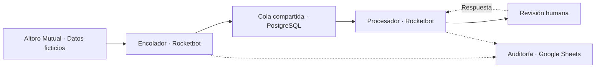

# RPA TestFire

Automatización de la conciliación de movimientos bancarios con **Rocketbot y Python**. Dos robots trabajan sobre los datos ficticios de Altoro Mutual, comparan los movimientos con un maestro interno y preparan un reporte Excel para que una persona revise las diferencias.

Proyecto académico de **Benjamín Palma y Gustavo Espinoza**. Ambos desarrollaron juntos el flujo completo para la asignatura Automatización de Procesos Robóticos I de Duoc UC.

## Cómo funciona

| Robot | Responsabilidad |
| --- | --- |
| **Encolador** | Extrae los movimientos del banco de demostración, valida los datos y los concilia con el maestro local. Consulta el dólar observado para convertir los montos a CLP, genera el reporte Excel y encola los avisos con su adjunto. |
| **Procesador** | Toma los casos de la cola compartida, envía los avisos y prepara un resumen para el supervisor. Lee las respuestas por IMAP y registra la decisión como `APROBADO`, `RECHAZADO` o `REVISAR`. |



Los robots pueden ejecutarse en equipos distintos. La cola PostgreSQL, alojada en Neon en la evaluación, comparte los casos y sus adjuntos. El sistema evita volver a encolar el mismo caso, reintenta fallos temporales y continúa procesando los demás cuando un envío falla. Las respuestas ambiguas quedan pendientes de revisión humana.

## Probar la cola en simulación

Con **Windows y Python 3**, abre una consola en la raíz del repositorio y ejecuta lo siguiente.

```bat
py -m pip install -r requirements-eval3.txt
scripts\demo_cola_1000.bat
```

Si tu instalación usa `python` como lanzador, úsalo en lugar de `py`. La demo usa una **cola SQLite local** con **1.000 casos ficticios**. Simula un error temporal en el caso 10, una dirección inválida en el 401 y una interrupción tras procesar 600 casos. Cuando pulses una tecla, reanudará el procesamiento y exportará `tracker_demo_1000.xlsx` a `%USERPROFILE%\Rocketbot_Salida` o a la ruta definida en `RPA_SALIDA`.

La simulación funciona con Python y guarda los mensajes como archivos locales, sin enviar correos reales ni conectarse a Neon. Cada ejecución vuelve a crear su propia base de prueba `cola_demo.db`.

## Ejecutar los robots en Rocketbot

El flujo completo usa **Windows, Python 3 y Rocketbot Studio**. El Encolador requiere Firefox y Excel de escritorio para sus pasos de extracción y presentación del reporte. Ambos robots usan la misma cola PostgreSQL y el flujo de correo se integra por SMTP e IMAP.

1. Usa [la configuración de ejemplo](config/config.eval3.example.json) como base para crear `config/config.json`. Configura el correo y agrega `cola.url` con la conexión compartida, o define `RPA_COLA_URL`. Guarda las credenciales en la configuración local.
2. En el equipo que extrae y concilia, ejecuta [`instalar_encolador.bat`](instalar_encolador.bat). En el que procesa los avisos, ejecuta [`instalar_procesador.bat`](instalar_procesador.bat).
3. Importa los archivos generados bajo `rocketbot/listo/` en Rocketbot Studio. Ejecuta primero el Encolador y después el Procesador.

Los lanzadores [`encender_robots.bat`](encender_robots.bat), [`estado_robots.bat`](estado_robots.bat) y [`apagar_robots.bat`](apagar_robots.bat) gestionan la ejecución programada. La disponibilidad del modo horario depende de la configuración y de la licencia de Rocketbot.

## Resultados y trazabilidad

| Evidencia | Qué permite comprobar |
| --- | --- |
| **Reporte Excel** | Movimientos conciliados, diferencias, filas rechazadas y referencia de la tasa de cambio. |
| **Seguimiento de envíos** | Estado e intentos por caso, errores y respuestas recibidas. |
| **Auditoría en Google Sheets** | ID de ejecución, etapa, estado, duración y enlace a la evidencia cuando está disponible. |
| **Registros locales** | Salida de cada etapa, con información para diagnosticar fallos de ejecución. |

La evaluación documentó una extracción de **100 movimientos** del banco de demostración. La prueba de **1.000 casos** corresponde a la simulación de la cola.

## Dónde está el código

- [Plantilla del Encolador](rocketbot/RPA_TestFire_Encolador.json) y [plantilla del Procesador](rocketbot/RPA_TestFire_Procesador.json) en Rocketbot.
- [Conciliación y reporte](scripts/conciliar_excel_rocketbot.py), [encolado](scripts/dispatcher_correos.py) y [procesamiento](scripts/performer_correos.py) en Python.
- [Cola compartida](src/cola_postgres.py), [bitácora](src/bitacora.py) y [pruebas automatizadas](tests/).
- [Documentación técnica de la evaluación](docs/eval3/README.md) con el detalle de subprocesos, validaciones y reintentos.
- [Flujo inicial en Python y Selenium](main.py).
