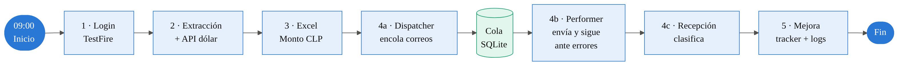

# Evaluación 3: API pública → Excel → Correo → Mejora creativa

Robot sobre el mismo caso TestFire, diseñado como **flujo secuencial con
subprocesos anidados**. El envío de correos usa el patrón **dispatcher /
performer** con una cola y su tracker.



Diagrama completo, con decisiones y manejo de errores: [`topologia.png`](topologia.png).
La fuente es `topologia.mmd` (Mermaid) y se puede editar en mermaid.live.

## Subprocesos y qué los implementa

| # | Subproceso | Quién lo hace | Archivo |
|---|---|---|---|
| 1 | Login en TestFire | Rocketbot (robot v5) | — |
| 2 | Extracción + conciliación | Rocketbot + `conciliar_rocketbot.bat` | `scripts/conciliar_excel_rocketbot.py` |
| 2 | Consumo de API (dólar) | `referencia_externa.bat` | `src/api_dolar.py` |
| 3 | Integración en Excel | `referencia_externa.bat`; Rocketbot abre, guarda y cierra el libro en Excel | `scripts/referencia_externa_excel.py` |
| 4a | Dispatcher: encola | `dispatcher.bat` | `scripts/dispatcher_correos.py` |
| 4b | Performer: envía | `performer.bat` | `scripts/performer_correos.py`, `src/canales_correo.py` |
| 4c | Recepción y clasificación | *pendiente: depende de la decisión de Outlook* | — |
| 5 | Mejora creativa: tracker + logs | `performer.bat` (exporta el tracker) | `src/bitacora.py`, `src/cola_correos.py` |
| 5 | Mejora creativa: ejecución programada 09:00 | *pendiente* | — |

## Orden en Rocketbot

Cada `.bat` deja una línea JSON en `<Rocketbot_Salida>\*_stdout.log`.
Rocketbot la lee para tomar la ruta que necesita el paso siguiente.

1. Login y extracción → `consolidado.xlsx`
2. `conciliar_rocketbot.bat` → `discrepancias_X.xlsx`
3. `referencia_externa.bat "<discrepancias_X.xlsx>"` → `reporte_final_X.xlsx` (columna `monto_clp` y hoja "Referencia externa")
4. Rocketbot abre `reporte_final_X.xlsx` en Excel, lo revisa, lo guarda y **lo cierra**
5. `dispatcher.bat "<reporte_final_X.xlsx>"` → casos en la cola
6. `performer.bat "<reporte_final_X.xlsx>"` → envíos y hoja "Seguimiento de envíos"

## API pública: mindicador.cl

- `GET https://mindicador.cl/api/dolar`: pública, sin autenticación, datos del Banco Central.
- **Validaciones**: HTTP 200, JSON con `codigo = "dolar"`, serie no vacía y valor entre 300 y 3000 CLP.
- **Errores**: ante un timeout o un error 5xx hace 3 intentos (espera 1 s y 2 s). Ante un 4xx o un JSON inválido no reintenta. Si todo falla, usa el último valor bueno en caché y lo deja marcado como "Caché local" en el Excel y en el log.
- **Evidencia**: `api_dolar_<fecha>.json` con la respuesta recibida.

## Cola de correos (dispatcher / performer)

**Estados de cada caso:**
- `PENDIENTE`: en espera.
- `EN_PROCESO`: lo tomó un performer.
- `ENVIADO`: salió bien.
- `ERROR`: falla pasajera; se reintenta al final, hasta 3 intentos.
- `FALLIDO`: dirección inválida o intentos agotados; no se reintenta.

**Garantías:**
- **Un error no detiene la cola**: si falla el 401, sigue con el 402.
- **Se puede retomar**: si el robot se cae en el 600, la próxima ejecución parte en el 601.
- **No duplica**: re-ejecutar el dispatcher no vuelve a encolar el mismo correo.
- **Admite performers en paralelo**: cada caso se toma con un UPDATE atómico, así que dos performers nunca toman el mismo.
- **Recupera casos atascados**: los que quedaron `EN_PROCESO` hace más de 15 minutos vuelven a `PENDIENTE`.

**Envío responsable:**
- Un correo por destinatario con todas sus excepciones, no uno por caso.
- Tope de 20 correos por ejecución en un canal real, con un máximo absoluto de 50.
- 10 segundos entre correos (el límite de Microsoft 365 es 30 por minuto).
- Las direcciones `@example.com` nunca salen por un canal real.

**Demo para la presentación**: `scripts\demo_cola_1000.bat`. Encola 1000 casos y deja el 401 con una dirección inválida y el 10 con una caída pasajera. Corta en 600 y retoma. Todo en modo simulación.

## Logs: 3 niveles

| Nivel | Dónde | Qué |
|---|---|---|
| Auditoría RPA | Google Sheets (las mismas 12 columnas) | Un evento por fase: API, Excel, Dispatcher, Performer, Tracker |
| Archivo local | `logs/rpa_AAAAMMDD.log` | Todo, línea por línea. Se escribe aunque no haya internet |
| Tracker | `data/cola/cola_correos.db` + hoja "Seguimiento de envíos" | Estado, intentos y error de cada correo |

## Configuración

En `config/config.json` (no se sube a GitHub):

```json
"correo": {
  "destinatarios": ["integrante1@duocuc.cl", "integrante2@duocuc.cl", "integrante3@duocuc.cl"]
}
```

Si no hay destinatarios, el dispatcher usa direcciones de prueba `@example.com`.
